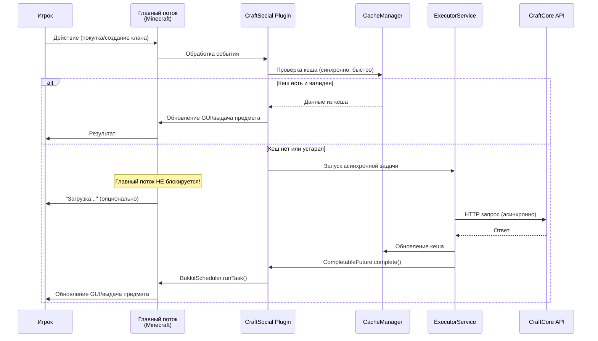

# План реализации CraftSocial Plugin

## Архитектура плагина

Плагин для Purpur 1.21.8 (Java), stateless архитектура с кешированием (TTL 10-30 сек). Все действия игроков валидируются через CraftCore API.

### Критически важно: Асинхронность

**Все операции с API должны быть полностью асинхронными**, чтобы не блокировать главный поток сервера и не уронить TPS. Никаких синхронных HTTP запросов в главном потоке!

- Все HTTP запросы выполняются в отдельном ExecutorService
- Использование CompletableFuture для цепочек асинхронных операций
- Callback механизмы для обработки ответов
- Синхронизация с главным потоком через BukkitScheduler.runTask()
- Неблокирующие операции для всех действий игроков

### Диаграмма асинхронного потока



### Структура проекта

```
CraftSocial/
├── src/main/java/dev/sh3lby/craftsocial/
│   ├── CraftSocialPlugin.java          # Главный класс плагина
│   ├── api/
│   │   ├── ApiClient.java              # Асинхронный HTTP клиент для CRM API
│   │   ├── ApiResponse.java            # Обертка для ответов API
│   │   ├── ApiException.java           # Исключения API
│   │   └── ApiCallback.java            # Callback интерфейс для асинхронных операций
│   ├── async/
│   │   ├── AsyncTaskManager.java       # Менеджер асинхронных задач
│   │   └── TaskQueue.java              # Очередь задач для ExecutorService
│   ├── cache/
│   │   ├── CacheManager.java           # Менеджер кеша (TTL 10-30 сек)
│   │   └── CacheEntry.java             # Запись кеша
│   ├── config/
│   │   └── PluginConfig.java           # Конфигурация (API URL, токены)
│   ├── handlers/
│   │   ├── PlayerHandler.java          # Обработка действий игрока
│   │   ├── ShopHandler.java            # Обработка магазинов
│   │   ├── ClanHandler.java            # Обработка кланов
│   │   └── PartyHandler.java           # Обработка групп
│   ├── gui/
│   │   ├── GuiManager.java              # Менеджер GUI
│   │   ├── ShopGui.java                 # GUI магазина
│   │   └── ClanGui.java                 # GUI клана
│   ├── listeners/
│   │   └── PlayerListener.java          # Слушатели событий
│   └── utils/
│       ├── ErrorHandler.java            # Обработка ошибок
│       └── Logger.java                   # Логирование
├── src/main/resources/
│   ├── plugin.yml                       # Метаданные плагина
│   └── config.yml                       # Конфигурация
└── docs/
    └── wait_for_release.md              # Нереализованные функции
```

## Реализуемые функции (доступны в API)

### 1. Player Management

- **API**: `/user/profile`, `/user/analytics`
- **Функционал**: Получение профиля игрока, баланса (через транзакции), текущих объединений (clan_id, party_id из analytics)
- **Реализация**: `PlayerHandler` использует `/user/profile` и `/user/analytics` для получения данных игрока

### 2. Economy

- **API**: `/user/transactions` (POST для создания транзакций)
- **Функционал**: Создание транзакций (transfer, payment, reward)
- **Реализация**: `PlayerHandler` использует POST `/user/transactions` для переводов и платежей
- **Ограничение**: Нет прямых `/economy/charge` и `/economy/transfer` - используем `/user/transactions`

### 3. Shops

- **API**: `/user/shops` (CRUD), `/user/shops/{id}/items`
- **Функционал**: 
  - Создание/управление магазинами
  - Добавление/управление товарами
  - GUI для покупки
- **Реализация**: `ShopHandler` + `ShopGui`
- **Поток покупки**:

  1. Игрок открывает GUI магазина
  2. Плагин получает данные через GET `/user/shops/{id}`
  3. При покупке: создаем транзакцию через POST `/user/transactions` (transaction_type: "payment")
  4. При успехе - выдаем предмет
  5. При ошибке - отменяем операцию

### 4. Clans

- **API**: `/user/clans` (CRUD), `/user/clans/{id}/members`, `/user/clans/{id}/members/{id}/role`
- **Функционал**:
  - Создание/управление кланами
  - Управление участниками и ролями
  - Казна (через транзакции)
- **Реализация**: `ClanHandler` + `ClanGui`
- **Ограничение**: Нет `/clan/{id}/permissions` и `/clan/action` - используем существующие endpoints для проверки ролей

### 5. Party

- **API**: `/user/parties` (CRUD), `/user/parties/{id}/members`, `/user/parties/{id}/transfer-leadership`
- **Функционал**:
  - Создание/управление группами
  - Управление участниками
  - Передача лидерства
- **Реализация**: `PartyHandler`
- **Ограничение**: Нет `/party/join` и `/party/action` - используем POST `/user/parties/{id}/members` для присоединения

### 6. Friends

- **API**: `/user/friends` (полный CRUD)
- **Функционал**: Система друзей
- **Реализация**: `PlayerHandler`

### 7. Notifications & Announcements

- **API**: `/user/notifications`, `/user/announcements`
- **Функционал**: Отображение уведомлений и объявлений
- **Реализация**: `PlayerHandler` + GUI

## Нереализованные функции (вынести в wait_for_release.md)

### 1. Contract System

- **Требуется**: POST `/contract/create`, POST `/contract/execute`
- **Статус**: Полностью отсутствует в API
- **Функционал**: Система контрактов с залогами, санкциями, автоисполнением

### 2. Reputation System

- **Требуется**: API для репутации игроков и кланов
- **Статус**: Полностью отсутствует в API
- **Функционал**: Метрики репутации, история изменений, источники влияния

### 3. Player Action Validation

- **Требуется**: POST `/player/action/validate`
- **Статус**: Отсутствует в API
- **Функционал**: Валидация действий игрока перед выполнением

### 4. Economy Endpoints

- **Требуется**: POST `/economy/charge`, POST `/economy/transfer`
- **Статус**: Отсутствуют прямые endpoints (есть только `/user/transactions`)
- **Примечание**: Можно использовать `/user/transactions`, но нет прямого соответствия

### 5. Shop Purchase Endpoint

- **Требуется**: POST `/shop/purchase`
- **Статус**: Отсутствует в API
- **Примечание**: Можно эмулировать через `/user/transactions` + логику плагина

### 6. Clan Permissions & Actions

- **Требуется**: GET `/clan/{id}/permissions`, POST `/clan/action`
- **Статус**: Отсутствуют в API
- **Примечание**: Можно использовать проверку ролей через `/user/clans/{id}/members`

### 7. Party Actions

- **Требуется**: POST `/party/action`
- **Статус**: Отсутствует в API
- **Примечание**: Базовый функционал доступен через CRUD

### 8. Server Token Authentication

- **Требуется**: Server-token для аутентификации
- **Статус**: Только X-Player-ID в API
- **Функционал**: Аутентификация сервера для системных запросов

### 9. Player Session Token

- **Требуется**: Player-session token (ephemeral)
- **Статус**: Отсутствует в API
- **Функционал**: Временные токены для сессий игроков

### 10. Webhook Invalidation

- **Требуется**: Webhook для инвалидации кеша
- **Статус**: Не документировано в API
- **Функционал**: Получение webhook'ов от CRM для обновления кеша

### 11. Clan Advanced Features

- **Требуется**: 
  - Уровень клана
  - Репутация клана
  - Виртуальный склад
  - Автоштрафы за нарушения
  - Клановые контракты
- **Статус**: Частично отсутствует (нет уровня, репутации, склада, автоштрафов, контрактов)

### 12. Party Advanced Features

- **Требуется**: 
  - TTL для групп
  - Правила (PvP, инвентарь, телепорт)
- **Статус**: Отсутствует в API

### 13. Shop Advanced Features

- **Требуется**:
  - owner_type (player | clan)
  - Налоговая модель
  - Правила доступа
  - История транзакций магазина
- **Статус**: Частично отсутствует (нет owner_type, налоговой модели, правил доступа)

## Технические детали реализации

### Асинхронная архитектура (КРИТИЧНО!)

**Все HTTP запросы должны быть неблокирующими:**

1. **AsyncTaskManager** - управляет ExecutorService для HTTP запросов

   - Отдельный thread pool для API запросов (не главный поток!)
   - Настраиваемый размер пула потоков
   - Graceful shutdown при выключении плагина

2. **ApiClient** - полностью асинхронный

   - Все методы возвращают `CompletableFuture<T>`
   - Использование OkHttp Async или HttpClient (async)
   - Callback механизмы для обработки результатов
   - Timeout настройки для предотвращения зависаний

3. **Синхронизация с главным потоком**

   - Использование `BukkitScheduler.runTask()` для обновления GUI
   - Использование `BukkitScheduler.runTaskAsynchronously()` для фоновых операций
   - Никогда не вызывать Bukkit API из асинхронного потока напрямую

4. **Пример потока покупки (асинхронно)**:
   ```
   Игрок жмёт купить
   → Плагин: проверка кеша (синхронно, быстро)
   → Если нет в кеше: AsyncTaskManager.execute(() -> {
       ApiClient.validatePurchase() // асинхронный запрос
         .thenCompose(response -> ApiClient.charge() // следующий асинхронный запрос
         .thenAccept(result -> {
           BukkitScheduler.runTask(plugin, () -> {
             // Только здесь обновляем GUI и выдаём предмет
             player.getInventory().addItem(item);
           });
         })
         .exceptionally(error -> {
           BukkitScheduler.runTask(plugin, () -> {
             player.sendMessage("Ошибка покупки");
           });
           return null;
         });
     });
   ```

5. **Обработка ошибок асинхронно**

   - Все исключения ловятся в CompletableFuture.exceptionally()
   - Логирование в асинхронном потоке
   - Уведомления игроку через главный поток

### Кеширование

- Использовать Caffeine или Guava Cache
- TTL: 10-30 секунд (настраиваемо)
- Read-only кеш
- Инвалидация при ошибках API или по таймауту
- **Кеш проверяется синхронно** (быстро, не блокирует), но обновление кеша - асинхронно

### Обработка ошибок

- При недоступности CRM:
  - Read-only режим (только чтение из кеша)
  - Отключение экономики (блокировка транзакций)
  - Отключение социальных действий (блокировка создания кланов/групп)
- Логирование всех ошибок
- Никаких silent fails

### Безопасность

- Rate limiting на стороне плагина (дополнительно к API)
- Retry логика с экспоненциальной задержкой
- Валидация всех ответов API

### Зависимости (Maven/Gradle)

- Purpur API 1.21.8
- **OkHttp** (рекомендуется) или **Apache HttpClient** для асинхронных HTTP запросов
  - OkHttp имеет встроенную поддержку async через Callback
  - HttpClient поддерживает CompletableFuture
- Gson или Jackson для JSON
- Caffeine для кеширования
- SLF4J для логирования

## Порядок реализации

1. **Базовая инфраструктура**: 

   - AsyncTaskManager (ExecutorService для HTTP запросов)
   - ApiClient (полностью асинхронный с CompletableFuture)
   - CacheManager, Config

2. **Player Management**: Профиль, баланс, базовые данные (асинхронно)
3. **Economy**: Транзакции через `/user/transactions` (асинхронно)
4. **Shops**: CRUD + GUI + покупка (асинхронный поток валидации)
5. **Clans**: CRUD + управление участниками + роли (асинхронно)
6. **Party**: CRUD + управление участниками (асинхронно)
7. **Friends**: Полный функционал (асинхронно)
8. **Notifications**: Отображение уведомлений (асинхронная загрузка)
9. **Error Handling**: Обработка недоступности CRM (read-only режим)
10. **Testing**: Тестирование всех сценариев, включая нагрузочное тестирование TPS

## Файл wait_for_release.md

Создать файл `docs/wait_for_release.md` со списком всех нереализованных функций из раздела выше, с указанием требуемых API endpoints и текущего статуса.